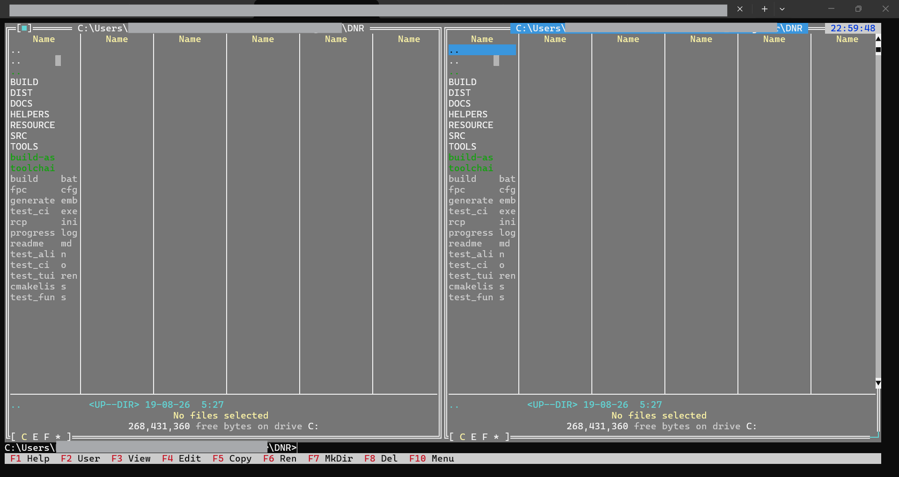

# DOS Navigator Revived (DNR)

[](https://github.com/DOS-Navigator/DNR)
[](https://www.freepascal.org/)
[](https://github.com/DOS-Navigator/DNR/actions/workflows/build-and-release.yml)
[](https://github.com/DOS-Navigator/DNR/releases)
[](https://github.com/DOS-Navigator/DNR)

**DOS Navigator Revived (DNR)** is an ongoing engineering initiative modernizing the legendary **DOS Navigator** file manager and desktop work environment (originally created by Stefan Tanurkov, Dmitry Dotsenko, Andrew Zabolotny, and RIT Research Labs) into a native, modern, 32-bit Windows console application using exclusively Free and Open Source Software (FPC and NASM).

<p align="center">
  
</p>

---

## Current Status (November 2026)

- **100% Monolithic & Portable Executable**: `dn.exe` is a completely standalone PE console executable with built-in embedded dialog and language resources (`DN.DLG`, `DN.LNG`, `DNRUS.DLG`, `DNRUS.LNG`). Runs standalone from any directory without external dependency files and without resource load crashes.
- **Native 32-bit Win32 PE Target**: Successfully builds and links `src/pascal/DN.PAS` into a native Windows console binary (`build/dn.exe`). No DOSBox, NTVDM, or 16-bit emulation required.
- **Modern Responsive Console TUI**: Fully responsive terminal layout supporting modern Windows Terminal, ConHost, and PTY environments:
  - **Dynamic Startup Viewport**: Automatically detects the active console buffer and window geometry (from standard 80×25 up to 300×150+).
  - **Live Resize Event Relayout**: Listens to Win32 `WINDOW_BUFFER_SIZE_EVENT` console events and dynamically resizes the view hierarchy (`TProgram`, `TDeskTop`, dual file panels `TDoubleWindow`, menu bar, command line, and status line).
  - **Dynamic Frame Buffering**: Eliminates legacy 80×50 (4,000 cell) limits and 16-bit `Word` size overflows via dynamic `LongInt` heap buffers.
- **Byte-Exact CP866 Preservation**: All source files and build pipelines enforce strict byte-exact single-byte encoding (`latin-1` byte stream) to preserve authentic CP866 extended ASCII box-drawing characters without UTF-8 corruption.
- **Automated TUI Testing**: Validated through headless PTY automation (`tools/surfaces/dn_surface.py` via `surfacekit`).

---

## Features & Modernization Highlights

* **Pure FLOSS Toolchain**: Built strictly using Free Pascal Compiler (FPC 3.2.2) and the Netwide Assembler (NASM 3.02+).
* **Direct Win32 Console API Integration**:
  - Console handles managed cleanly through `CONOUT$` and `CONIN$`.
  - Video rendering routed through `WriteConsoleOutputA` with dynamic `CharInfoBuf` allocation.
  - Keyboard and mouse events bridged to Win32 `ReadConsoleInputA`.
* **Legacy Borland Pascal 7 / Turbo Vision Compatibility**:
  - Flat 32-bit memory and heap compatibility shims (`PrefixSeg`, `HeapOrg`, `HeapEnd`, `HeapPtr`, `MemAvail`, `MaxAvail`).
  - Resolved namespace ambiguities between `Objects.TPoint` and `Windows.TPoint`.
  - Replaced 16-bit segmented inline assembly (`lds`/`les`) with 32-bit flat register operations.

---

## Prerequisites

1. **Free Pascal Compiler (FPC)**: Version 3.2.2 or later targeting `i386-win32` (`fpc.exe` / `ppc386.exe` on PATH).
2. **Netwide Assembler (NASM)**: Version 3.02 or later (`nasm.exe` on PATH).
3. **Operating System**: Windows 10, Windows 11, Windows Server, or Linux/macOS with Wine.

---

## Building from Source

### Quick Build (Windows Command Prompt or PowerShell)

Run the included automated build batch script:

```cmd
build.bat
```

The script compiles the resource compiler (`build\RCP.exe`), builds binary dialog and language resources, generates embedded resource tables, compiles `src/pascal/DN.PAS`, and outputs the monolithic executable to both `build\dn.exe` and `dist\dn.exe`.

### Clean Rebuild

```cmd
build.bat clean && build.bat
```

---

## Running DOS Navigator

Launch the compiled executable directly from any console (Windows Terminal, Command Prompt, or PowerShell):

```cmd
dist\dn.exe
```

### Command-Line Arguments

```
Usage: dn [options]
  /?          Display help message
  /C<file>    Specify configuration file
  /S<dir>     Specify swap directory
  /P<file>    Specify palette file
  /NOXMS      Disable XMS memory
  /NOEMS      Disable EMS memory
```

---

## Keyboard Shortcuts Reference

DOS Navigator features a comprehensive keyboard layout designed for high-efficiency terminal navigation, file management, and text editing.

### 1. Function Keys Matrix (F1 – F12)

| Key | Default (Alone) | Shift + Key | Ctrl + Key | Alt + Key |
|:---:|:----------------|:------------|:-----------|:----------|
| **F1** | **Help**: Context help index | **Copy to Archive**: Add to archive | **Toggle Left Panel**: Show/hide Panel 1 | **Drive Left**: Select drive for Panel 1 |
| **F2** | **User Menu**: Custom command menu | **Extract Archive**: Unpack archive | **Toggle Right Panel**: Show/hide Panel 2 | **Drive Right**: Select drive for Panel 2 |
| **F3** | **View**: View file (internal/ext) | **Phone Book**: Open dialer / phonebook | **New Manager**: Open new file panel | **Alternate View**: Force internal viewer |
| **F4** | **Edit**: Edit file | **Edit New**: Create & edit new file | **Close Window**: Close active window | **Alternate Edit**: Force internal editor |
| **F5** | **Copy**: Copy tagged files / dirs | **Split / Combine**: Long file copy | **Size / Move Window**: Relayout window | **User Screen**: Toggle full DOS console |
| **F6** | **Rename / Move**: Rename or move | **Reanimator**: Undelete files on FAT | **Calculator**: Open calculator tool | **Duplicate Line**: (In Editor) dup line |
| **F7** | **Make Directory**: Create folder | **Format Disk**: Format floppy / drive | **UU-Encode**: Encode binary to text | **Find File**: Search across drives |
| **F8** | **Delete**: Delete tagged files | **Single Delete**: Delete without confirm | **UU-Decode**: Decode UU-encoded file | **History**: DOS command history list |
| **F9** | **Next Window**: Switch active window | **Prev Window**: Switch backwards | **Print**: Send file to print manager | **Game**: Rest game (Tetris / Pentix) |
| **F10** | **Main Menu**: Activate top menu bar | **EGA/VGA Lines**: Toggle 25/43/50 lines | **Custom Video 2**: User video mode 2 | **Custom Video 1**: User video mode 1 |
| **F11** | — | **SpreadSheet**: Open spreadsheet | **CD Player**: Built-in CD player | **NavyLink**: Remote PC link |
| **F12** | — | — | — | — |

---

### 2. File Panels & File Operations (`Alt` & `Ctrl` Alphabet Keys)

| Shortcut | Action | Description |
|:---|:---|:---|
| `Alt + A` | **Manual Dial** | Open terminal / modem dialing dialog |
| `Alt + B` | **Sort Method** | Change panel sort order (Name, Extension, Size, Date/Time, Unsorted) |
| `Alt + C` | **Change Drive** | Change disk drive for the active panel |
| `Alt + D` | **Disk Menu** | Open disk utility menu |
| `Alt + E` | **File Attributes** | View and modify file attributes (Archive, Hidden, Read-Only, System) |
| `Alt + F` | **File Menu** | Open the main File operations menu |
| `Alt + G` | **Directory Size** | Calculate total recursive size and file count of highlighted folder |
| `Alt + H` | **Disconnect** | Hang up active modem connection |
| `Alt + I` | **Info Panel** | Toggle drive and memory information in the opposite panel |
| `Alt + J` | **Terminal** | Open built-in serial communications terminal |
| `Alt + K` | **Setup Columns** | Configure visible columns and widths for file panels |
| `Alt + L` | **Make List File** | Export names of selected files to a text file |
| `Alt + M` | **Manager Menu** | Open file manager commands menu |
| `Alt + N` | **Archiver Setup** | Select and configure active archiver (ZIP, RAR, ARJ, LHA, etc.) |
| `Alt + O` | **Options Menu** | Open configuration and preferences menu |
| `Alt + P` | **Panel Menu** | Open panel display options menu |
| `Alt + Q` | **SmartPad™** | Open SmartPad scratchpad text notes editor |
| `Alt + R` | **Re-read** | Force re-reading and refreshing the active panel directory |
| `Alt + S` | **Panel Setup** | Configure panel appearance, hidden files, mini-status line |
| `Alt + T` | **Directory Tree** | Open visual directory tree dialog for quick directory jumping |
| `Alt + U` | **Utilities Menu** | Open tools menu (Calculator, Calendar, Phonebook, etc.) |
| `Alt + V` | **Read List File** | Load external list of files into a panel |
| `Alt + W` | **Window Menu** | Open window list and tiling/cascading controls |
| `Alt + X` | **Exit** | Quit DOS Navigator |
| `Alt + Y` | **Memory Info** | Display detailed conventional, XMS, and EMS memory usage |
| `Alt + Z` | **Zoom Window** | Maximize or restore the active window size |
| `Alt + 0` | **Window List** | Show list of all open windows for rapid switching |
| `Alt + Backspace` | **Dir History** | Show history list of previously visited directories |
| `Alt + Del` | **Advanced Filter** | Open file filter configuration (by date, size, attributes) |
| `Ctrl + B` | **ASCII Table** | Display interactive ASCII character chart |
| `Ctrl + C` | **Compare Dirs** | Compare left and right directories (highlight differences) |
| `Ctrl + H` | **Dir Branch** | Flatten and display all files in directory tree recursively |
| `Ctrl + L` | **Disk Info** | Toggle disk drive statistics in passive panel |
| `Ctrl + O` | **Output Screen** | Show/hide the DOS output console window |
| `Ctrl + P` | **Hide Inactive** | Hide or show the passive (inactive) file panel |
| `Ctrl + Q` | **Quick View** | Open live preview viewer of highlighted file in opposite panel |
| `Ctrl + R` | **Re-read** | Re-read and refresh the current directory |
| `Ctrl + T` | **Tree Panel** | Convert panel to full visual directory tree view |
| `Ctrl + U` | **Swap Panels** | Swap contents and positions of left and right panels |

---

### 3. File Tagging, Selection & Wildcards

| Shortcut | Action | Description |
|:---|:---|:---|
| `Ins` / `Space` | **Toggle Tag** | Select / unselect highlighted file or folder and move cursor down |
| `Gray +` | **Select Group** | Select files matching wildcard pattern (e.g. `*.PAS; *.ASM`) |
| `Gray -` | **Unselect Group** | Unselect files matching wildcard pattern |
| `Gray *` | **Invert Selection** | Invert tag state of all files in active directory |
| `Ctrl + Gray +` | **Select Type** | Select all files matching highlight group of current file |
| `Ctrl + Gray -` | **Unselect Type** | Unselect all files matching highlight group of current file |
| `Ctrl + Shift + Gray +` | **Select Ext** | Select all files with the exact same file extension |
| `Ctrl + Shift + Gray -` | **Unselect Ext** | Unselect all files with the exact same file extension |
| `Ctrl + Ins` | **Copy Names** | Copy names of all tagged files to Clipboard |
| `Shift + Del` | **Single Delete** | Delete highlighted file directly (skipping multi-file queue) |

---

### 4. Navigation & Directory Bookmarks (Quick Dirs)

| Shortcut | Action | Description |
|:---|:---|:---|
| `Enter` | **Open / Execute** | Enter directory, enter archive file, or execute program |
| `Shift + Enter` | **Execute Secondary** | Execute program using secondary association parameter |
| `Alt + Enter` | **Execute Menu** | Open context menu of actions defined for this file extension |
| `Ctrl + PgUp` | **Parent Directory** | Navigate up to parent directory (`..`) or exit archive / search |
| `Ctrl + \` | **Root Directory** | Jump directly to root directory (`\`) of active drive |
| `Alt + 1` .. `Alt + 9` | **Quick Dir Jump** | Instantly jump to bookmarked directory slot 1 through 9 |
| `Ctrl + Shift + Alt + 1..9` | **Set Quick Dir** | Save current directory to quick bookmark slot 1 through 9 |
| `Alt + Shift + 0` | **Quick Dirs List** | Display and manage all saved quick directory bookmarks |

---

### 5. Command Line Integration

| Shortcut | Action | Description |
|:---|:---|:---|
| `Ctrl + Enter` | **Insert Name** | Paste current file name onto DOS command line |
| `Ctrl + Shift + Enter` | **Insert Full Path** | Paste absolute pathname of current file onto command line |
| `Ctrl + [` | **Insert Left Path** | Paste current directory path of left panel onto command line |
| `Ctrl + ]` | **Insert Right Path** | Paste current directory path of right panel onto command line |
| `Alt + F8` | **Command History** | Open searchable history dialog of executed console commands |
| `Up` / `Down` | **Command Recall** | Browse previously entered commands when cursor is on command line |

---

### 6. Window Management & Desktop Controls

| Shortcut | Action | Description |
|:---|:---|:---|
| `Alt + Tab` / `F9` | **Next Window** | Cycle forward through open windows |
| `Ctrl + Tab` / `Shift + F9` | **Previous Window** | Cycle backward through open windows |
| `Ctrl + F4` | **Close Window** | Close active editor, viewer, or tool window |
| `Ctrl + F5` | **Resize / Move** | Enter window geometry mode (use arrow keys to move/resize, `Enter` to confirm) |
| `Alt + Z` | **Zoom** | Maximize active window to full screen or restore original size |
| `Alt + 0` | **List Windows** | Show window switcher modal list |
| `Alt + F5` | **User Screen** | Switch to underlying console screen buffer; press any key to return |
| `Ctrl + O` | **Output Window** | Open floating window displaying console output history |
| `Shift + Alt + Ins` | **Screen Grabber** | Capture a rectangular region of the text screen into Clipboard |
| `Alt + Q` | **SmartPad™** | Summon quick notepad dialog anywhere in the application |
| `Alt + X` | **Exit** | Prompt to exit DOS Navigator cleanly |

---

### 7. Internal Text Editor Shortcuts

The built-in text editor supports dual control paradigms: standard modern CUA hotkeys and classic Borland/WordStar two-key sequences.

#### Cursor Movement & Navigation

| Shortcut | WordStar Key | Action |
|:---|:---|:---|
| `Left` / `Right` | `Ctrl + S` / `Ctrl + D` | Move one character left / right |
| `Ctrl + Left` / `Ctrl + Right` | `Ctrl + A` / `Ctrl + F` | Move one word left / right |
| `Up` / `Down` | `Ctrl + E` / `Ctrl + X` | Move one line up / down |
| `Home` / `End` | — | Move to beginning / end of current line |
| `PgUp` / `PgDn` | `Ctrl + R` / `Ctrl + C` | Scroll one page up / down |
| `Ctrl + Home` / `Ctrl + End` | — | Jump to top / bottom of document |
| `Ctrl + W` / `Ctrl + Z` | — | Scroll screen up / down one line (cursor position preserved) |
| `Alt + G` | — | Go to line number |
| `Ctrl + K 0` .. `9` | — | Place bookmark marker `0` through `9` at cursor |
| `Ctrl + Q 0` .. `9` | — | Jump to bookmark marker `0` through `9` |

#### Block Operations & Clipboard

| Shortcut | WordStar Key | Action |
|:---|:---|:---|
| `Shift + Arrows` | — | Select block of text continuously |
| `Ctrl + K B` | — | Mark beginning of block |
| `Ctrl + K K` | — | Mark end of block |
| `Ctrl + Ins` | `Ctrl + K C` | Copy block to Clipboard |
| `Shift + Del` | `Ctrl + K V` | Cut block to Clipboard |
| `Shift + Ins` | — | Paste block from Clipboard at cursor |
| `Ctrl + Del` | `Ctrl + K Y` | Delete block without copying |
| `Ctrl + K R` | — | Read / insert file from disk into document |
| `Ctrl + K W` | — | Write marked block to disk file |
| `Ctrl + K I` / `Ctrl + K U` | — | Indent / unindent block |
| `Ctrl + B V` | — | Toggle vertical (columnar/rectangular) vs. horizontal block mode |
| `Ctrl + B L` / `R` / `C` / `J` | — | Align block left / right / center / justify |
| `Alt + T` | — | Sort lines inside marked block alphabetically |
| `Alt + Ins` | — | Calculate numerical sum of numbers within marked block |

#### Editing, Case Conversion & Utilities

| Shortcut | Action | Description |
|:---|:---|:---|
| `Ins` / `Ctrl + V` | **Insert Mode** | Toggle between Insert and Overwrite text mode |
| `Ctrl + Y` | **Delete Line** | Delete current line |
| `Ctrl + Q Y` | **Delete to EOL** | Delete text from cursor position to end of line |
| `Ctrl + Backspace` | **Delete Word Left** | Delete previous word |
| `Ctrl + T` | **Delete Word Right**| Delete word to the right |
| `F6` | **Duplicate Line** | Duplicate the current line below |
| `Alt + Backspace` | **Undo** | Multilevel undo buffer |
| `Tab` / `Shift + Tab` | **Tab / Unindent** | Insert tab character or unindent current line |
| `F4` / `Ctrl + Q M` | **Line Drawing** | Toggle pseudo-graphic box drawing mode (arrow keys draw borders) |
| `Ctrl + P` | **Insert Symbol** | Open ASCII chart to insert special or extended character |
| `Ctrl + Q D` | **Insert Date** | Insert current date string (formatted) at cursor |
| `Ctrl + Q T` | **Insert Time** | Insert current time string at cursor |
| `Ctrl + [` | **Uppercase Word** | Convert current word to UPPERCASE |
| `Ctrl + ]` | **Lowercase Word** | Convert current word to lowercase |
| `Ctrl + \` | **Capitalize Word** | Capitalize First Letter Of Current Word |
| `Ctrl + Shift + [` | **Uppercase Line** | Convert entire line to UPPERCASE |
| `Ctrl + Shift + ]` | **Lowercase Line** | Convert entire line to lowercase |
| `Ctrl + Shift + \` | **Capitalize Line** | Capitalize Words Across Entire Line |

#### Search & Replace

| Shortcut | WordStar Key | Action |
|:---|:---|:---|
| `F7` | `Ctrl + Q F` | Search for text string (supports whole word, case sensitive) |
| `Ctrl + F7` | `Ctrl + Q A` | Search and replace text |
| `Shift + F7` | `Ctrl + L` | Repeat last search |
| `Alt + F7` | — | Search backward (reversed search direction) |

#### File & Window Operations in Editor

| Shortcut | Action | Description |
|:---|:---|:---|
| `F2` / `Ctrl + K S` | **Save** | Save current file to disk |
| `Shift + F2` | **Save As** | Save file under new name or path |
| `Ctrl + F2` | **Save All** | Save all modified open files across all editor windows |
| `F3` | **Open** | Open another file for editing |
| `F8` | **Print** | Send active file to printer |
| `Shift + F8` | **Print Block** | Send selected block to printer |
| `Ctrl + F4` | **Close** | Close active editor window |

---

### 8. Internal File Viewer Shortcuts

| Shortcut | Action | Description |
|:---|:---|:---|
| `F2` | **Toggle Wrap** | Toggle line wrap on/off (wrap long lines to window width) |
| `F4` | **Hex / Text Mode** | Toggle between ASCII Text and Hexadecimal view mode (Hex mode supports in-place editing) |
| `F7` | **Search** | Search for text string or hexadecimal byte sequence |
| `Shift + F7` | **Search Next** | Continue search for next match |
| `Alt + F3` / `Esc` | **Close Viewer** | Close file viewer window |

---

### 9. Built-in Utilities & Subsystems

#### SpreadSheet (`.WKZ`) Table Editor

| Shortcut | Action | Description |
|:---|:---|:---|
| `F2` / `Shift + F2` | **Save / Save As** | Save spreadsheet table |
| `F3` | **Open** | Open existing spreadsheet |
| `F4` | **New** | Create new spreadsheet table |
| `Alt + Backspace` | **Undo** | Undo last cell edit |
| `Shift + Del` | **Cut** | Cut cell contents |
| `Ctrl + Ins` | **Copy** | Copy cell contents |
| `Shift + Ins` | **Paste** | Paste cell contents |
| `Ctrl + Del` | **Clear** | Clear selected cell range |
| `Ctrl + F4` / `Esc` | **Close** | Close spreadsheet window |

#### Low-Level Disk Editor

| Shortcut | Action | Description |
|:---|:---|:---|
| `Alt + F` | **Open File** | Open file for direct cluster analysis |
| `Alt + R` | **Open Directory** | Open directory structure |
| `Alt + D` | **Open Drive** | Select drive for raw sector editing |
| `Alt + C` | **Open Cluster** | Jump to specific cluster number |
| `Alt + S` | **Open Sector** | Jump to specific logical sector number |
| `F2` | **Hex Mode** | Display sector contents in hexadecimal |
| `F3` | **Dir Mode** | Decode sector as directory entries table |
| `F4` | **Text Mode** | View sector as raw ASCII text |
| `F5` | **FAT Mode** | Decode and browse File Allocation Table |
| `F7` / `Shift + F7` | **Search / Next** | Search for byte pattern or text across sectors |
| `Alt + Backspace` | **Undo** | Revert sector modifications |
| `Alt + F3` | **Exit** | Exit disk editor |

---

## Automated TUI Testing

Automated testing is driven by the surface test utility in `tools/surfaces/dn_surface.py`:

```cmd
:: Run selftest (verifies startup landmark and clean Alt+X exit)
python tools/surfaces/dn_surface.py selftest

:: Capture the active screen layout across the current terminal dimensions
python tools/surfaces/dn_surface.py screen
```

---

## Repository Structure

```
DNR/
├── build/                 # Compiled binaries and unit output artifacts (.exe, .ppu, .o)
├── dist/                  # Monolithic portable distribution binaries and zip archives
├── helpers/               # Legacy build and conversion utilities
├── resource/              # Binary resources, menus, and help definitions
├── src/
│   ├── asm/               # Assembly sources modernized for NASM / 32-bit
│   └── pascal/            # Turbo Pascal / Turbo Vision sources (DN.PAS, DRIVERS.PAS, etc.)
├── tools/
│   └── surfaces/          # TUI surface automation drivers (dn_surface.py)
├── build.bat              # One-click native Win32 build script
└── README.md              # Project documentation
```

---

## License & Credits

DOS Navigator was originally developed by RIT Research Labs (Stefan Tanurkov, Dmitry Dotsenko, Andrew Zabolotny) and open-sourced under the DOS Navigator Open Source License / GNU General Public License. See `PROGRESS_LOG.md` and source file headers for historical documentation and contributor credits.
